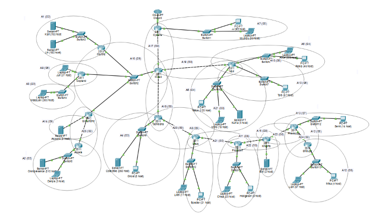

# Jarkom-Modul-4-2026-K-19
## Anggota Kelompok
| Nama | NRP |
| --- | --- |
| Ni Putu Maqueenta Wijaya | 5027251004 |
| Malikha Syafira Dewi | 5027251032 |
## Laporan
### CPT - VLSM

1. **Topologi CPT**

   Berikut topologi yang dibuat untuk Cisco Packet Tracer:

   

   Setelah dilakukan analisa terhadap topologi tersebut, dapat disimpulkan terdapat sebanyak **25 subnet** yang perlu dihitung, yaitu 16 subnet LAN + 9 link P2P antar router (Cloud **tidak** dihitung sebagai subnet; interface router yang menghadap Cloud memakai blok cadangan `10.73.16.100/30` di luar tabel).

2. **Total penggunaan subnet**

   Jumlah IP setiap subnet dihitung dari **jumlah host ditambah interface router** yang berada pada subnet tersebut (poin 8 soal). Total kebutuhan adalah **2814 IP**, sehingga blok induk yang mencakup seluruh subnet adalah **10.73.0.0/19** (prefix kelompok 10.73.x.x). Pendekatan terbesar adalah mendapatkan subnet **/22**, dan terkecil **/30** untuk link P2P.

   Rincian pembagian (VLSM, dari terbesar ke terkecil):

   | Subnet | Rute | Kebutuhan IP | Network ID | Prefix |
   | --- | --- | --- | --- | --- |
   | A1 | Psyche > Switch3 > Karl (700), Lin (180) | 881 | 10.73.0.0 | /22 |
   | A2 | Accela > Switch5 > Omnipresence (510), Denpa (3) | 514 | 10.73.4.0 | /22 |
   | A3 | Copland > Switch4 > Masayuki (300) | 301 | 10.73.8.0 | /23 |
   | A4 | Tachibana > Switch9 > Collective (260), Ghost (6) | 267 | 10.73.10.0 | /23 |
   | A5 | Navi > Switch6 > Alice (208), Reika (45) | 254 | 10.73.12.0 | /24 |
   | A6 | Navi > Switch8 > Yasuo (120), Miho (18), Kuma (4) | 143 | 10.73.13.0 | /24 |
   | A7 | Cyberia > Switch1 > JJ (95), MyuMyu (30) | 126 | 10.73.14.0 | /25 |
   | A8 | Deus > Switch10 > Lilith (77), Specter (21) | 99 | 10.73.14.128 | /25 |
   | A9 | Copland > Juri (31) | 32 | 10.73.15.0 | /26 |
   | A10 | Navi > Switch7 > Taro (57) | 58 | 10.73.15.64 | /26 |
   | A11 | Protocol7 > Switch11 > Chisa (23), Hodgeson (9) | 33 | 10.73.15.128 | /26 |
   | A12 | Shibuya > Switch13 > Lain (57), Mika (4) | 62 | 10.73.15.192 | /26 |
   | A13 | Phamoma > Switch12 > Semi (14) | 15 | 10.73.16.0 | /27 |
   | A14 | Schumann > Akashic (3) | 4 | 10.73.16.32 | /29 |
   | A15 | Knights > Eiri (2) | 3 | 10.73.16.40 | /29 |
   | A16 | Switch2 Segment (Wired - Psyche - Copland - Schumann) | 4 | 10.73.16.48 | /29 |
   | A17 | P2P Cyberia - Wired | 2 | 10.73.16.64 | /30 |
   | A18 | P2P Wired - Tachibana | 2 | 10.73.16.68 | /30 |
   | A19 | P2P Wired - Navi | 2 | 10.73.16.72 | /30 |
   | A20 | P2P Tachibana - Deus | 2 | 10.73.16.76 | /30 |
   | A21 | P2P Deus - Protocol7 | 2 | 10.73.16.80 | /30 |
   | A22 | P2P Protocol7 - Knights | 2 | 10.73.16.84 | /30 |
   | A23 | P2P Knights - Phamoma | 2 | 10.73.16.88 | /30 |
   | A24 | P2P Phamoma - Shibuya | 2 | 10.73.16.92 | /30 |
   | A25 | P2P Schumann - Accela | 2 | 10.73.16.96 | /30 |

   Perhitungan lengkap (Network ID, Broadcast, Range IP per subnet) dapat dilihat pada `Jarkom_K19_revisi.xlsx`.

   #### Studi Kasus Perhitungan: Subnet A1

   **a. Menentukan Prefix (VLSM)**

   - Kebutuhan IP: Karl (700) + Lin (180) + 1 interface router Psyche = **881 IP**.
   - Rumus: $2^n - 2 \geq 881$.
   - Pencarian $n$ (bit host):
     - $2^9 = 512$ (kurang)
     - $2^{10} = 1024$ (cukup) → maka $n = 10$.
   - Prefix: $32 - n = 32 - 10 = $ **/22**.

   **b. Menghitung Block Size (Total IP)**

   - Rumus: $2^{(32 - \text{Prefix})} = 2^{(32-22)} = 2^{10} = $ **1024** IP.
   - Karena 1 oktet bernilai 256, maka $1024 / 256 = 4$. Ini berarti subnet ini memakan **4 angka** pada oktet ketiga IP.

   **c. Menentukan Network ID (NID) & Broadcast**

   - **Network ID (Awal):** A1 adalah subnet pertama, maka NID dimulai dari **10.73.0.0**.
   - **Next Network (Batas Atas):** NID Awal + Block Size (di oktet ke-3) → $0 + 4 = 4$. Jadi subnet berikutnya dimulai di `10.73.4.0`.
   - **Broadcast Address (Akhir):** Satu angka sebelum *Next Network* (`10.73.4.0`). Maka Broadcastnya adalah **10.73.3.255**.

   **d. Menentukan Range IP Usable**

   - **IP Pertama:** Network ID + 1 → **10.73.0.1** (dipakai interface Psyche).
   - **IP Terakhir:** Broadcast - 1 → **10.73.3.254**.

3. **Routing (OSPF)**

   Agar IP dan routing seefisien mungkin (poin 4 soal), kita menggunakan routing dinamis **OSPF single-area** (area 0) pada semua 13 router, dibandingkan static routing yang harus mengisi rute manual di setiap router.

   - Setiap router cukup meng-advertise jaringan yang terhubung langsung (`network ... area 0`), lalu semua rute ke subnet lain dipelajari otomatis lewat LSA.
   - Setiap router diberi **router-ID unik** agar adjacency stabil dan tidak ada konflik.
   - Hasil verifikasi: 13 router OSPF, 30 neighbor, **semua status FULL** (topologi konvergen penuh), tanpa static/RIP/EIGRP.

4. **Konfigurasi IP & NAT**

   Setiap router dan client dikonfigurasi statis sesuai tabel VLSM di atas. Konfigurasi dilakukan melalui CLI router (IP address per interface + `no shutdown`) dan IP Configuration pada tiap client/server.

   Router **Cyberia** merupakan satu-satunya router yang terhubung ke NAT/Cloud (poin 7 soal). Pada Cyberia dipasang NAT overload (PAT) agar seluruh LAN bisa keluar lewat satu interface:

   ```
   access-list 100 permit ip 10.73.0.0 0.0.31.255 any
   ip nat inside source list 100 interface FastEthernet0/0 overload
   ```

   (interface `Fa0/0` ke Cloud sebagai `ip nat outside`, sisanya `ip nat inside`)

5. **Testing Koneksi (Ping)**

   Validasi dilakukan dengan ping antar node dari subnet yang berbeda (lintas topologi), contohnya Karl (A1) → Juri (A9), Lain (A12) → Karl (A1), dan Eiri (A15) → Denpa (A2). Seluruh 18 arah ping antar router P2P dan ping antar-LAN **berhasil (100%)**, membuktikan semua node saling terhubung (poin 5 soal).
